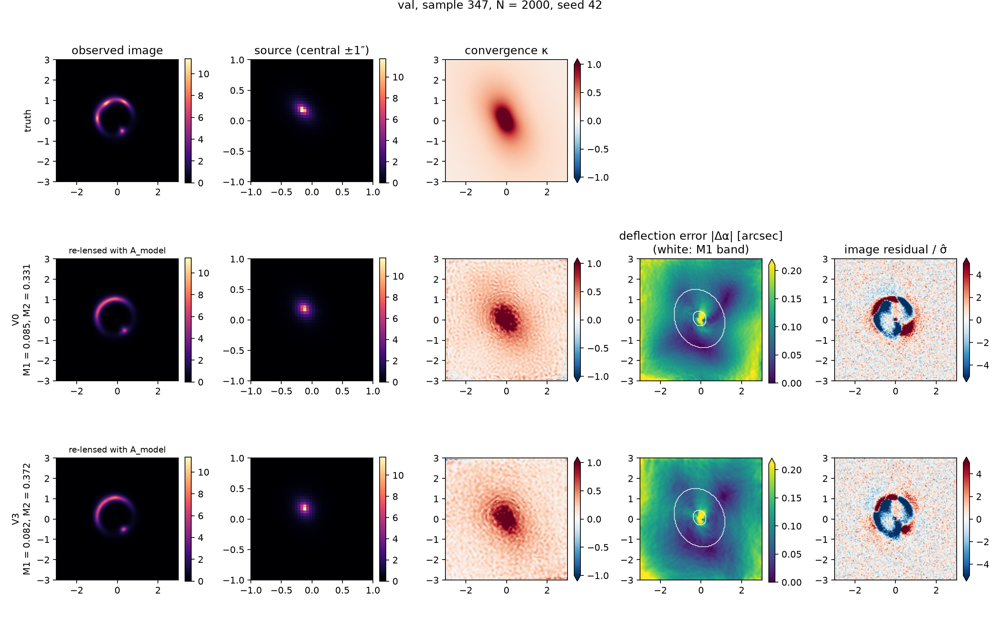
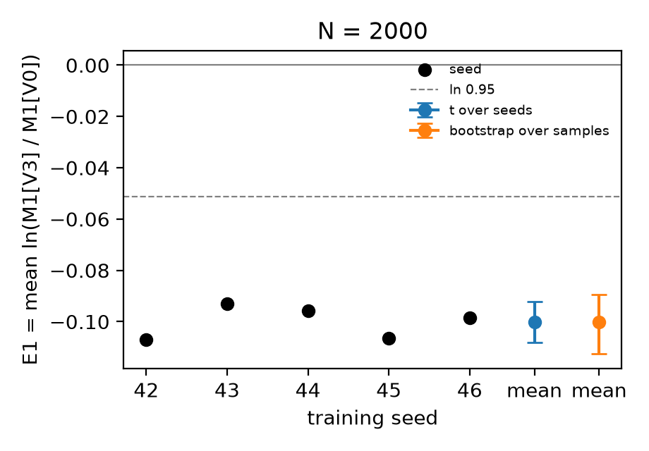
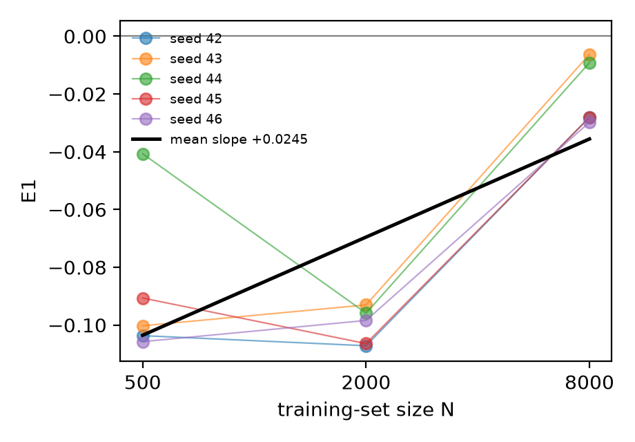

# PI-FNO: Physics constraints and out-of-distribution generalization in gravitational-lensing inversion

[](https://doi.org/10.5281/zenodo.24164618)

A controlled study of whether physical constraints in the loss of a Fourier Neural Operator (FNO) improve the reconstruction of the lens potential $\psi$ and the unlensed source $S$ from a single noisy image, **outside the training distribution**, and whether the effect grows when training data are scarce.

**In short.** A neural network reads one simulated image of a galaxy lensed by another galaxy and recovers the lens mass and the background galaxy. Adding the physics of lensing to its training loss lowers the mass-reconstruction error by about 10%, both on data like the training set and on six kinds of data the network has never seen. The gain comes mainly from asking the network to reproduce the observed image, holds for a second architecture (U-Net), grows further with unlabelled images and is not reproduced by a generic smoothness penalty. All of this follows a protocol frozen and archived before the first training run, with every later change logged.



*A validation lens (N = 2 000, seed 42): truth in the top row, the plain network (V0) and the physics-informed one (V3) below; columns show the image, the source, the convergence κ, the deflection error and the image residual.*

The study follows a protocol frozen before the first training run: [`PROTOCOL_en.md`](PROTOCOL_en.md) (Polish version: [`PROTOCOL_pl.md`](PROTOCOL_pl.md)). Every change made after freezing is logged in §13 of the protocol.

**Status:** complete. All runs specified in the protocol are finished and evaluated; the [results](#results) are summarized below.

---

## Research question and hypotheses

Architecture, data and training budget are held fixed; only the loss changes.

- **H1 (primary).** The full physics-constrained variant (V3) has a lower deflection error in the Einstein-ring band (M1) than the supervised baseline (V0), aggregated over the out-of-distribution (OOD) axes, at N = 2 000 training samples.
- **H2.** The effect in H1 grows as the number of training samples decreases (N ∈ {500, 2 000, 8 000}).
- **H3.** In distribution, V3 is not worse than V0 by more than 5% in M1 and M2.

Decision rules, thresholds and the statistical procedure are fixed in §10 of the protocol. A null result is reported as a result.

## Scope

Synthetic data only: an isothermal elliptical-potential lens with external shear and a Sérsic source, with no lens-galaxy light, on a 128×128 grid (±3″, pixel 47.2 mas) with a Gaussian PSF of FWHM 0.10″ and Gaussian noise whose variance combines a background term and a Poisson-like term proportional to the flux. Conclusions do not extend to real data, other lens families or other loss functions (protocol §12).

## Data and operators

- **Observations** are generated by `A_truth`: ray tracing on a 255×255 grid, PSF convolution, then every second pixel to 128×128.
- **The loss** uses `A_model` on the 128×128 grid. Both operators share the ray tracer, PSF and bilinear interpolation; they differ in resolution and in how the source is sampled. Experiment S4 measures how much the results depend on this difference.
- **Datasets** are finite and stored on disk as `.npy` with SHA-256 checksums: train 8 000 (nested subsets 500 / 2 000 / 8 000), val 1 000, test ID 500.
- **OOD test sets** reuse the test-ID seeds: each OOD sample shares the base parameter draw `u` and the noise realization `z` with its test-ID twin, so only the shifted factor differs.

| Axis | Shift | Levels |
|---|---|---|
| A1 | parameter extrapolation: θ_E, lens q, shear, source position | 3 |
| A2 | profile slope `ψ ∝ r^s` | 3 |
| A3 | Plummer substructure near the ring | 3 |
| A4 | three Gaussian clumps instead of a Sérsic source | 1 |
| A5 | background noise σ₀ outside the training range | 3 |
| A6 | PSF mismatch (0.12″, 0.15″ instead of 0.10″) | 2 |

OOD sets are used only in the final evaluation, never for tuning or checkpoint selection.

A separate diagnostic axis, Kneg, mirrors A3 with the sign of the substructure reversed, so that the true convergence is negative in places and the positivity constraint is wrong. It is reported on its own and does not enter the primary endpoint.

## Variants

All variants share one FNO (modes 32, width 64), one dataset and one procedure: 12 500 AdamW steps with OneCycleLR, batch 16. Physics terms are switched on gradually between steps 1 500 and 3 000.

| Variant | Loss | Description |
|:---:|---|---|
| V0 | `L_sup` | supervised baseline on deflection α = ∇ψ and source |
| V1 | `L_sup + λ_pos·L_pos` | adds mass positivity, penalizing κ = ½∇²ψ < 0 |
| V2 | `L_sup + λ_ray·L_ray` | adds ray-tracing consistency with the observation (pseudo-Huber on the noise-normalized residual) |
| V3 | `L_sup + λ_ray·L_ray + λ_pos·L_pos` | both constraints |

λ_ray, λ_pos, learning rate and weight decay are tuned on the validation set with an equal budget for every variant (protocol §7.1); the selected values are stored in `configs/tuned.yaml`. Five seeds (42–46) per variant and N, paired across variants.

## Metrics

Computed per sample on the 128×128 grid (protocol §8):

| ID | What it measures |
|---|---|
| M1 | relative deflection error in the band \|r_ell − θ_E\| < 0.5″ around the true Einstein ring |
| M1b | as M1, after removing the mean deflection-error vector in the band (a constant offset is degenerate with a source shift) |
| M1c | as M1, after also removing the best-fitting mass-sheet transformation in the band (exploratory) |
| M2 | relative source error within 1.0″ of the true source centre |
| M3 | relative potential error after removing the constant in ψ |
| M4 | relative deflection error over the full field |
| M4b | source centroid error [mas] and flux error in the M2 aperture |
| M5 | unclipped χ² of the re-lensed reconstruction, on the arc and globally |
| M6 | fraction of interior pixels with κ < 0 |

M5 and M6 favour the variants that optimize these quantities and are reported separately.

## Control experiments

Descriptive controls, specified in §9 of the protocol, were run after the final evaluation: sensitivity to the form of the χ² term (S1), to the architecture with a U-Net of matching size (S2), to the noise estimate (S3) and to the mismatch between `A_truth` and `A_model` (S4); and exploratory runs X1–X5, including a non-physical smoothness penalty (X4, only if H1 is supported) and a conventional parametric fit as a reference point (X5).

## Results

Effects are log ratios of median errors against V0 (negative = lower error; −0.10 ≈ 9.5% lower), averaged over five training seeds (42–46), with 95% intervals: for H1 and H3 the wider of the t interval over seeds and the bootstrap interval over test samples (§10), elsewhere the t interval. Decisions follow §10 of the protocol and are recorded in §13. Full tables are produced by `scripts/make_tables.py`, `scripts/make_controls.py` and `scripts/run_x5.py`.

### Hypotheses

| | Criterion (fixed before the final evaluation) | Result | Decision |
|---|---|---|---|
| H1 | Mean OOD effect of V3 on the deflection error M1 at N = 2 000 (E1) ≤ ln 0.95 | E1 = −0.100 [−0.113, −0.089], negative in 5 of 5 seeds | supported |
| H2 | Slope of E1 on ln N ≥ 0.0185 | 0.0245 [0.014, 0.035], positive in 5 of 5 seeds | supported |
| H3 | V3 at most 5% worse than V0 in distribution (M1, M2) | upper bounds −0.083 (M1) and −0.031 (M2) | supported |



*H1: the effect of the physics terms (E1) for each training seed at N = 2 000, and their mean with the t interval over seeds (blue) and the bootstrap interval over test samples (orange). All five seeds lie well below the threshold ln 0.95 (dashed), the smallest effect the study treats as meaningful.*



*H2: E1 against the training-set size for each seed, with the mean fitted slope (black). The effect is similar at N = 500 and 2 000 and much smaller at N = 8 000.*

What the numbers say, and what they do not:

- **The physics terms reduce the deflection error by 8–11% on every OOD axis**, but by about the same amount in distribution (9.8%). They make the model more accurate overall rather than specifically better at generalizing.
- **The ray-tracing term carries most of the effect.** V2 (`L_ray` only) is significant on all six axes; V1 (`L_pos` only) on two (A1, A4).
- **H2 is driven by the largest training set.** E1 is −0.088 at N = 500, −0.100 at N = 2 000 and −0.020 at N = 8 000: the effect does not keep growing as data shrink, it fades once data are plentiful.

### Controls (descriptive, §9)

| Control | What changes | Result (M1 averaged over the E1 axes unless stated) |
|---|---|---|
| S4 | Observations generated with the loss operator (`A_model`) | E1 = −0.096, as in the main experiment (−0.100): the gain does not come from operator agreement |
| S2 | U-Net of matching size instead of the FNO | E1 = −0.126: the physics gain carries over; the U-Net itself is about 40% more accurate than the FNO OOD |
| S1 | Clamped χ² instead of pseudo-Huber | about 2% higher error |
| S3 | True noise map instead of the estimate | no difference |
| X1 | Physics terms only, no labels (V4) | error about 15–20× higher: physics alone does not identify ψ |
| X2 | `L_ray` and `L_pos` also on 8 000 unlabelled images | a further −0.14 OOD (−0.20 in distribution) over V3 |
| X3 | Repeat of two tuning runs | `val_select` differs by 0.2% between repeats, the size of the gaps between tuning configurations |
| X4 | Generic curvature penalty instead of physics | within 1% of V0 and about 10% worse than V3: the gain is not generic regularization |
| X5 | Parametric fit of the true model family, 8 starts | M1 0.004 in distribution vs 0.046 for V3, also better on A2–A4; a reference, not a competitor: it fits the generator's own model and takes seconds per lens |

### Limitations

- All data are simulated: a single band, no light from the lens galaxy, analytic lens and source profiles. Nothing here has been tested on real observations.
- Hyperparameters were tuned only at N = 2 000, so the dependence on N (H2) may partly reflect settings less suited to N = 500 and 8 000.
- Model selection uses a labelled validation set, which a real survey would not have.
- The FNO is not the most accurate architecture for this task: a U-Net of matching size has about 40% lower error out of distribution and about 50% lower in distribution.
- A parametric fit of the true model family is far more accurate (X5); the networks are faster, not better, when the model family is known.

## Repository layout

```
configs/prior.yaml        parameter ranges of the training family
configs/tuned.yaml        hyperparameters selected by tuning
src/physics/              profiles, ray tracer, operators, noise, Poisson solver
src/data/                 generator (ID, OOD, diagnostic and S4), splits, on-disk storage
src/losses/               L_sup, L_ray, L_pos, the curvature penalty of X4 and variants V0–V4, R
src/models/               FNO, spectral convolution, U-Net for control S2
src/training/trainer.py   training loop, checkpoint selection, run metadata
src/evaluation/           metrics, per-run evaluation, statistics of §10, tables, figures
src/fitting/              parametric reference fit (X5)
scripts/                  dataset generation, tuning, experiments, evaluation, tables, figures
results/tuning.json       validation results of the 36 tuning runs
results/tuning_s2.json    U-Net learning-rate tuning (S2)
results/tuning_x4.json    λ_R tuning (X4)
results/x3.json           repeat of two tuning runs (X3)
results/x5/               parametric reference fit (X5)
docs/figures/             figures used in this README
tests/                    unit tests
```

## Setup and usage

Python 3.12 and an NVIDIA GPU. From the repository root:

```
python -m venv .venv
.venv\Scripts\Activate.ps1            # Linux/macOS: source .venv/bin/activate
pip install -r requirements.txt --extra-index-url https://download.pytorch.org/whl/cu124

python -m scripts.make_datasets       # writes data/ (train, val, test_id, ood/*)
python -m scripts.make_datasets_diag  # writes data/diag/ (negative-mass control axis, outside the primary endpoint)
python -m pytest tests -q
python -m scripts.tune                # 36 runs, writes configs/tuned.yaml
python -m scripts.run_emain           # 60 runs of the main experiment

python -m scripts.evaluate_all --final  # per-sample metrics on test ID, OOD and diagnostic sets
python -m scripts.make_tables           # hypotheses H1-H3, tables and dose-response figures
python -m scripts.make_figures --final --set test_id  # validation curves and example reconstructions
python -m scripts.run_x5 --final        # parametric reference fit (exploratory)
python -m scripts.make_datasets_s4      # writes data_s4/ for control S4 (observations from A_model)
python -m scripts.run_s4                # 10 runs of control S4
python -m scripts.run_x3                # X3: repeat of two tuning configurations
python -m scripts.run_s2                # S2: U-Net lr tuning (3 runs) and 10 runs
python -m scripts.run_s1                # S1, S3, X1, X2, X4: one script each
python -m scripts.run_s3
python -m scripts.run_x1
python -m scripts.run_x2
python -m scripts.run_x4
python -m scripts.evaluate_all --final --only S1_   # likewise S2_, S3_, S4_, X1_, X2_, X4_
python -m scripts.make_controls        # tables of all controls
```

Test, OOD and diagnostic sets are read only with `--final`; the first such evaluation writes `results/metrics/FINAL_EVALUATION.json`, and the figure and fitting scripts refuse to read those sets before that file exists.

One FNO training run takes about 72 minutes on a GTX 1660: about 43 h for tuning and 72 h for the main experiment. A U-Net run (S2) takes about 2 h and an X2 run about 8 h, because X2 needs a second forward pass and, on a 6 GB card, most likely spills GPU memory into system memory. Run each control script in its own process: several U-Net runs in one process slowed down the same way.

## Reproducibility

- Datasets are regenerated bit for bit from their seeds; `meta.json` in each dataset stores the checksums and the hash of `configs/prior.yaml`.
- Each run stores its configuration, best `val_select`, git commit and dirty flag (read once when the training process starts), PyTorch version and GPU name in `runs/<name>/meta.json`.
- The main datasets were generated with PyTorch 2.15.0 (CPU) and everything else with the pinned 2.6.0+cu124; `scripts/check_dataset_regeneration.py` confirms that the pinned version reproduces the stored arrays bit for bit.
- GPU training is not bitwise deterministic; repeated runs with the same seed can differ slightly. Control X3 measures the size of this effect.
- Compute: 159 training runs, about 260 GPU-hours in total, plus evaluation, all on a single NVIDIA GTX 1660 (6 GB).

## Use of AI assistance

The project grew out of an earlier prototype by the author and was extended and refined with the help of an AI coding assistant (Claude, Anthropic). The author directed the work, reviewed and tested every change against her understanding of the physics and of the network, ran all experiments and interpreted the results.

## Citation and license

To cite the project, use [10.5281/zenodo.24164618](https://doi.org/10.5281/zenodo.24164618) (all versions). The frozen protocol and the code before any test-set evaluation are archived as version `protocol-v1.0` ([10.5281/zenodo.24164619](https://doi.org/10.5281/zenodo.24164619)) and, with the code used for the final evaluation, as version `protocol-v1.2` ([10.5281/zenodo.24312573](https://doi.org/10.5281/zenodo.24312573)). See `LICENSE` for the license terms.
